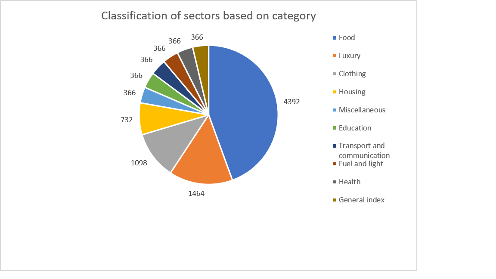
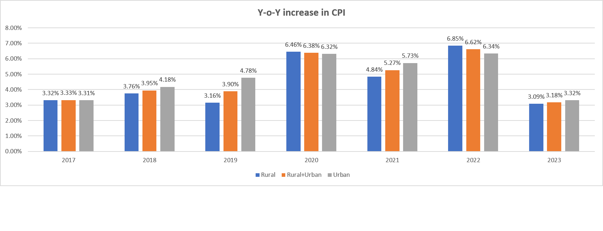
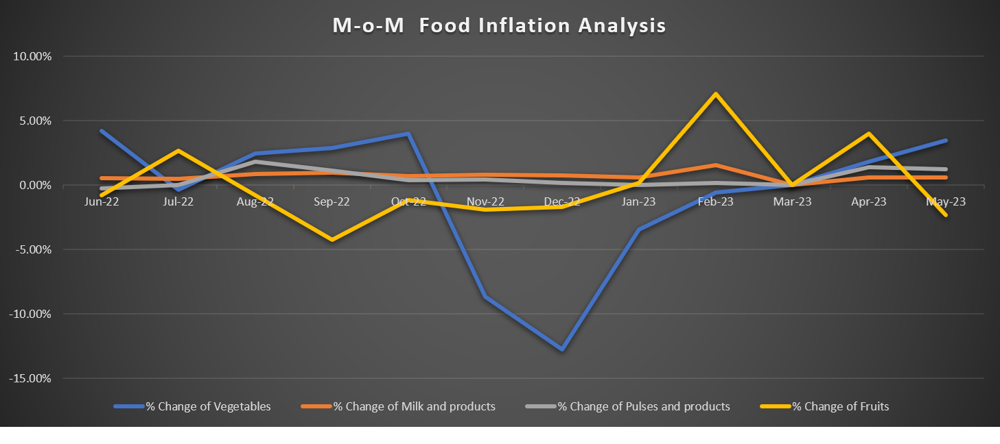
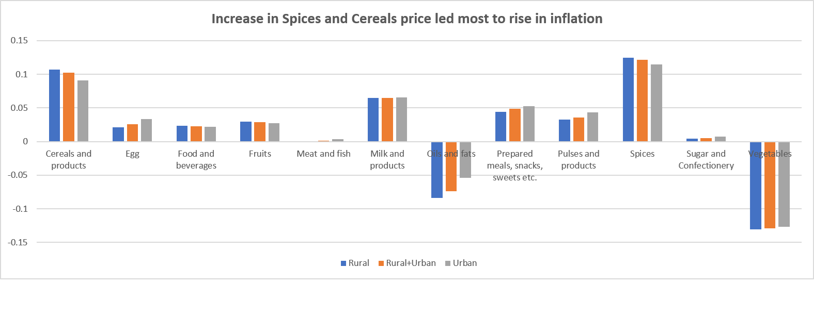
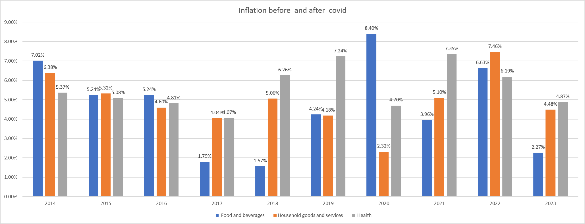
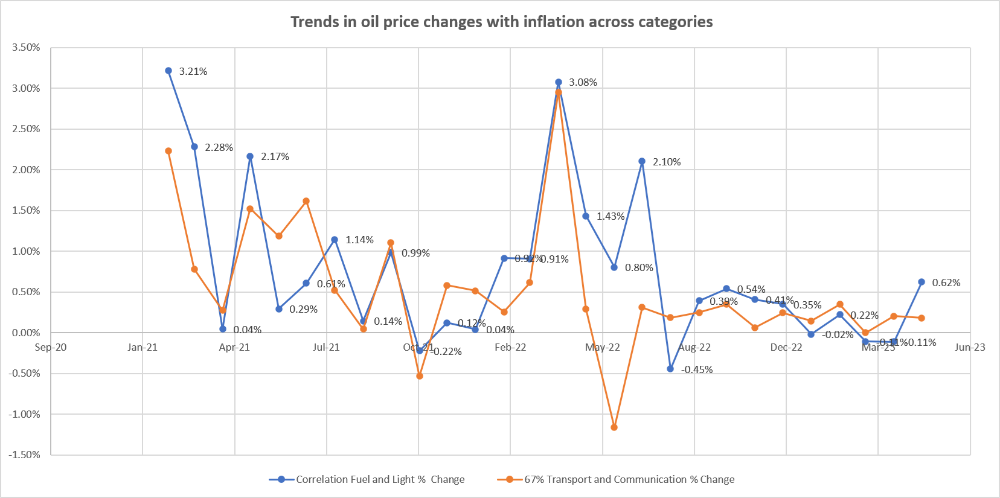

# India CPI Inflation Analysis — Uncovering Inflation Trends Using Excel


## 📌 Overview

This project analyzes India's Consumer Price Index (CPI) inflation using Microsoft Excel and Power Query. It focuses on preparing data, exploring inflation trends, and presenting findings through charts and visualizations.

## 📊 Dataset

- **Source:** Refer to the source details in the project workbook.
- **Data:** Consumer Price Index (CPI) inflation data for India.
- **Purpose:** Explore available inflation patterns and trends.

## 🛠️ Tools & Techniques

- Microsoft Excel
- Power Query
- Data Cleaning and Transformation
- Data Analysis
- Charts and Data Visualization

## 🔍 Approach

1. Imported the CPI data into Excel.
2. Prepared and cleaned the available data using Excel and Power Query.
3. Explored CPI inflation trends and patterns.
4. Created charts to communicate the analysis visually.
5. Organized the workbook and findings for easier interpretation.

## 💡 Key Insights

The key findings and observations are available in the Excel workbook. This section can be updated with specific results after verifying the analysis.

## 📷 Dashboard Preview

### 1. Contribution of Categories in the CPI Basket



### 2. Year-over-Year Inflation Trend



### 3. Month-on-Month Food Category Growth



### 4. Spices and Cereals Inflation Drivers



### 5. Pre- vs. Post-COVID Inflation Comparison



### 6. Fuel and Transport Inflation Correlation Trend



## 📁 Repository Structure

```text
India-CPI-Inflation-Analysis/
├── README.md
├── cpi-basket-contribution.png
├── yoy-inflation-trend.png
├── mom-food-category-growth.png
├── spices-cereals-inflation-drivers.png
├── pre-post-covid-inflation.png
└── oil-price-correlation-trend.png
```

*The image files listed above should be uploaded to the repository's main folder. Update this structure if your actual filenames or files differ.*

## ▶️ How to Reproduce

1. Download or open the Excel workbook in this repository.
2. Review the data preparation and analysis steps.
3. Explore the charts and findings in Excel.

## 👤 Author

**Priya Kumari**

Data Analyst Aspirant | Excel | Power Query | Data Analysis

- **LinkedIn:** https://linkedin.com/in/priya-kumari-35227729b
- **GitHub:** https://github.com/Priya90884
